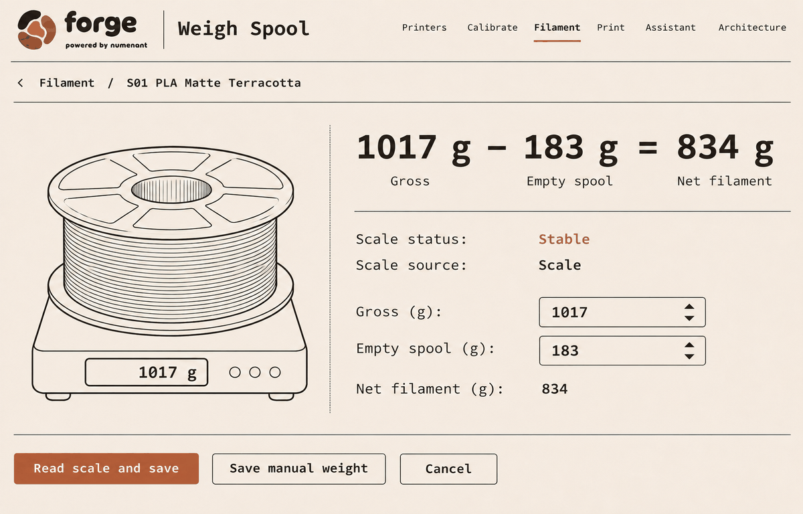

# Numenant

**The intelligence inside the work.**

Numenant understands the system it lives in and acts on it. One foundation, built to run any domain.

*In development*

**Checks its work**\
A change counts once it’s confirmed, not when it’s sent.

**Unknown stays unknown**\
A missing reading shows as unknown, never as zero.

**Suggestions first**\
Suggestions come with the readings behind them. You stay in control.

**Learns from you**\
Your preferences and corrections shape what it suggests next.

## Forge

Fabrication. Printing, finishing, and production.\
*In development*

**Filament by weight**\
Set a spool on the scale. Forge subtracts the empty spool and records what’s left.

**Calibration, test by test**\
Print a test, pick the best result, and save it to a preset or the printer.

**Every printer at a glance**\
What each printer is printing, what’s loaded, and which calibration it’s using.

**Review before it prints**\
Nothing starts until you confirm the bed is empty and the plate is seated.

**An assistant that advises**\
Ask why a print is stringing. Answers draw on your saved tests, and printing stays your call.

**Teach Forge**\
Correct an answer once, and Forge remembers.

## Grove

Cultivation.\
*In development*

## Hearth

The home. Climate, devices, and sensors.\
*In development*

**Every room in one place**\
Power, temperature, mode, fan speed, and airflow for each room’s air conditioner.

**Schedules**\
Create a recurring morning, bedtime, or away schedule for any combination of rooms.

**Scenes**\
Set your rooms just right, then save a scene.

**Smart rules**\
When a sensor reading rises above or falls below a line you set, a device responds.

**Intelligence**\
Hearth suggests changes from your readings, your usual day, and the weather outside, with the reasons behind each one.

**Household**\
Invite roommates, choose their access, and keep everyone’s space their own.

**Checked, every time**\
Hearth reads a device before every change and checks it after.

Built on Numenant.

## Read more

- [Forge](docs/forge.md)
- [Hearth](docs/hearth.md)
