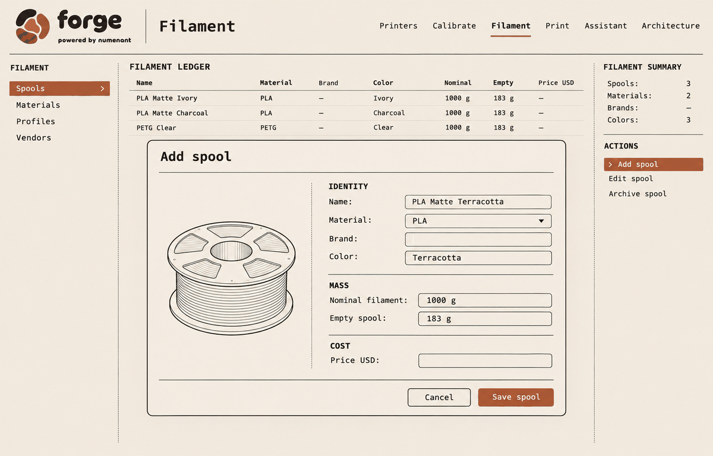
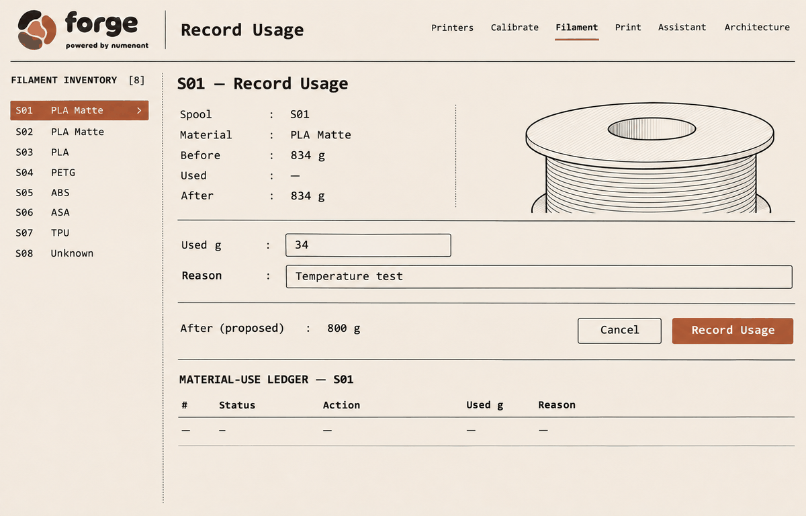

# Forge

**Fabrication. Printing, finishing, and production.**

Printers, calibration, filament, and prints, in one place.

*In development*

## Printers

**Every printer at a glance**\
What each printer is printing, what’s loaded, and which calibration it’s using.

**Honest when offline**\
When a printer goes quiet, its readings show as unknown, never as zero. Its last accepted calibration stays on record.

## Calibration

**Test by test**\
Temperature, flow dynamics, pressure advance, flow rate, and maximum volumetric speed. Forge plans each test and slices it for you.

**You pick the result**\
Inspect the printed test, then choose the best block, pattern, or patch.

**Saved where it counts**\
Write the result to a filament preset or save it to the printer. Forge shows you the change before it writes anything.

## Filament

**Weigh a spool**\
Set it on the scale. Forge subtracts the empty spool and records the filament that’s left.

**Add a spool once**\
Name, material, color, nominal weight, and the weight of the empty spool.

**Record usage**\
Log what a print or test used, and why.

**Know where it is**\
Assign a spool to a printer slot and see its full history.

## Print

**Review before it prints**\
Forge checks the file against the printer and the material. Nothing starts until you confirm the bed is empty and the plate is seated.

**Sent isn’t printing**\
Planned, sliced, reviewed, sent, printing, and accepted each mean something different. Forge keeps them apart.

**When it isn’t sure**\
If a printer never confirms a start, Forge marks the outcome unknown and doesn’t send the print again.

**Review the part**\
Mark a finished part acceptable or not, with notes. A finished print isn’t an accepted part until you say so.

## Assistant

**Ask about a print**\
Why is this PLA stringing? Answers draw on your saved prints and tests.

**Advice, not action**\
The assistant suggests. Starting a print stays with you.

**Ask out loud**\
Speak a question instead of typing it, and hear the reply read aloud.

**Teach Forge**\
Correct an answer once. Forge remembers it for one print or for every print.

**Gets better with you**\
Your corrections train a new version of the assistant. It takes over only after it proves better on answers you review.
